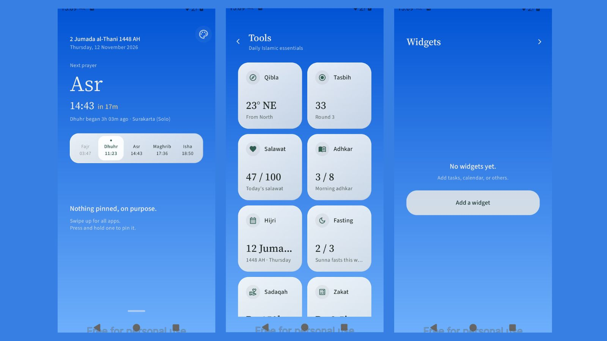

# Muslim Launcher

**by [Sadaqah Code](https://github.com/SadaqahCode)**

> **Most launchers are built to keep you engaged.**
> **Muslim Launcher is built to keep you aware.**

Muslim Launcher is an Android launcher designed around prayer, intention, and _muhasabah_ (self-reflection).

It approaches the smartphone not merely as a device for accessing apps, but as an _amanah_ — a responsibility that deserves conscious use.

No ads. No analytics. No tracking.

---

## Philosophy

Smartphones have become part of everyday life. We use them for communication, work, learning, entertainment, and countless other activities.

But convenience does not always mean benefit.

Muslim Launcher explores a different approach to smartphone interaction: one that encourages users to be more conscious of what they access, why they access it, and how they spend their attention.

The goal is not to eliminate technology, but to put it in its proper place.

## Features

### Home

- Prayer times and Hijri date as central elements.
- Prayer-focused home screen.
- Pinned applications and customizable dock.
- Custom wallpaper.

### App Organization

Applications are categorized according to their purpose and potential impact:

| Category            | Meaning                                                               |
| ------------------- | --------------------------------------------------------------------- |
| `Deen`              | Applications supporting religious practice and learning.              |
| `Dunya — necessary` | Applications needed for everyday responsibilities.                    |
| `Dunya — optional`  | Applications used for optional activities and entertainment.          |
| `Fitnah risk`       | Applications that may expose users to harmful or distracting content. |

These categories are intended as a framework for personal awareness and reflection, not as automatic judgments about users.

### App Drawer

- Application search.
- Category-based browsing.
- Personal and Work tabs.

### Widgets

- Add and remove widgets.
- Resize widgets.
- Reorder widgets.

## What Muslim Launcher Is Not

- **Not an Islamic-themed launcher.** Its foundation is a philosophy of intentional technology use, not visual decoration.
- **Not a screen-time tracker.** It focuses on awareness and intention rather than usage statistics.
- **Not a productivity tool.** Productivity is not its primary objective.
- **Not a parental control app.** It is designed around personal responsibility.

## Privacy

Muslim Launcher is designed to operate without unnecessary data collection.

- No advertisements.
- No analytics.
- No tracking.
- Offline-first functionality.

Your smartphone usage should not become another source of data extraction.

## Project Status

**Current version: 0.4.1**

The project is under active development.

| Component      | Status         |
| -------------- | -------------- |
| Home           | Implemented    |
| App Drawer     | Implemented    |
| App Categories | Implemented    |
| Widgets        | Implemented    |
| Gestures       | Implemented    |
| Tools          | Placeholder UI |

Features and implementation details may change as development progresses.

## Documentation

- [Roadmap](./docs/ROADMAP.md)
- [Developer Contract](./DEVELOPER_CONTRACT.md)
- [Changelog](./dev/CHANGELOG.md)

## Contributing

Contributions are welcome, provided they align with the project's philosophy and technical direction.

Before submitting a pull request, read the [Developer Contract](./DEVELOPER_CONTRACT.md).

A few principles:

- Keep implementations focused.
- Avoid unnecessary complexity.
- Do not introduce dependencies without clear justification.
- Respect the project's privacy and offline-first principles.
- Avoid feature additions that conflict with the project's purpose.

## License

Muslim Launcher is licensed under the **GNU General Public License v3.0**.

See [LICENSE](./LICENSE) for details.

## Contact

- **GitHub:** [SadaqahCode](https://github.com/SadaqahCode)
- **Issues:** Use [GitHub Issues](../../issues) to report bugs or propose improvements.

---

## About Sadaqah Code

**Sadaqah Code** is an Islamic open-source initiative building free, ad-free digital tools for Muslims.

Founded and maintained by [FlagoDNA](https://flagodna.com).

---

> **The phone is an _amanah_.**
> Muslim Launcher is built with that responsibility in mind.

**Bismillah.**
